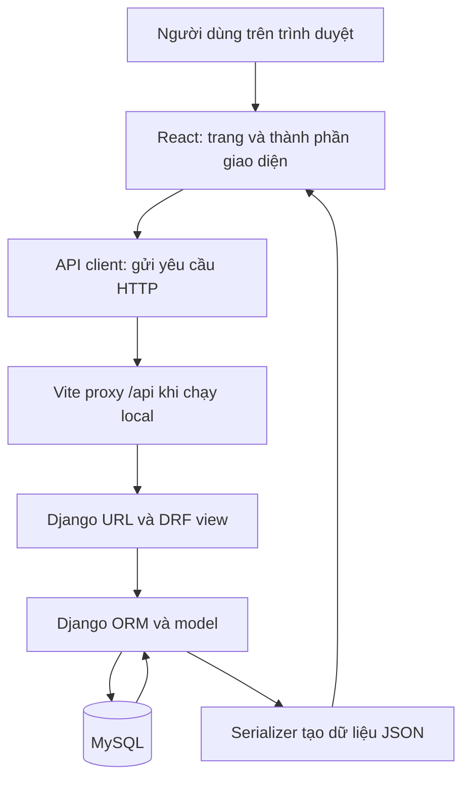

# Giải thích thiết kế và tổ chức hệ thống V-Connect — Giai đoạn 1

Ngày lập: 15/09/2026.

Tài liệu giải thích kiến trúc đã triển khai trong bản giai đoạn 1, đối chiếu với commit `1efcbed03fecc57d61b9b5ebc46659a22e32167a`. Workspace hiện đã có thêm giai đoạn 2; các API đăng ký, đăng nhập, đặt lại mật khẩu và bộ kiểm thử Playwright không thuộc phạm vi thiết kế được bàn giao ở giai đoạn 1.

Các lý do dưới đây là phần diễn giải thiết kế dựa trên code và phạm vi đã thống nhất, không phải trích dẫn nguyên văn báo cáo PDF. Yêu cầu trực tiếp của chủ dự án là cơ sở lựa chọn công nghệ và phạm vi.

## 1. Mục tiêu của thiết kế nền tảng

Giai đoạn 1 cần chứng minh được một đường đi dữ liệu hoàn chỉnh: người dùng mở website React, website gọi API Django, Django đọc MySQL và trả kết quả để hiển thị. Khi đường đi này hoạt động ổn định, các giai đoạn sau có thể tập trung vào hồ sơ, hoạt động và đăng ký tham gia.

Vì vậy, giai đoạn này ưu tiên cấu trúc dự án, kết nối database, schema ban đầu, quy ước API và cách chạy/kiểm tra. Hai API health và danh mục kỹ năng đủ để kiểm tra nền tảng mà chưa phải xây toàn bộ nghiệp vụ.

Với dự án do một người phát triển, cách tổ chức cần dễ tìm code, dễ chạy trên máy hiện có và có thể mở rộng theo từng giai đoạn. Số thư mục phản ánh các trách nhiệm khác nhau; không đồng nghĩa phải vận hành nhiều dịch vụ.

## 2. Kiến trúc tổng thể và đường đi của một yêu cầu



Ví dụ: trang chủ cần danh sách kỹ năng. React gọi `/api/v1/skills/`; Vite chuyển yêu cầu tới Django ở cổng 8000. Django đọc bảng `core_skill`, serializer chọn dữ liệu trả về, lớp phân trang đóng gói kết quả. React hiển thị dữ liệu hoặc trạng thái lỗi.

Frontend chịu trách nhiệm hiển thị và tương tác. Backend chịu trách nhiệm truy cập dữ liệu, kiểm tra yêu cầu và thực thi quyền. MySQL lưu dữ liệu bền vững. Trình duyệt không có mật khẩu MySQL và không truy cập database trực tiếp.

### Vì sao tách React và Django?

React phù hợp với giao diện có nhiều trạng thái như danh sách, bộ lọc, biểu mẫu và khu vực theo vai trò. Django cung cấp ORM, migrations, quản lý người dùng và trang quản trị; DRF bổ sung cách tổ chức API JSON. Việc tách hai phần giúp thay đổi giao diện mà không phải viết lại cách lưu dữ liệu, đồng thời cho phép kiểm tra API độc lập.

Đánh đổi là phải duy trì hai bộ thư viện và chạy hai tiến trình khi phát triển. Giao diện và API cũng cần thống nhất tên trường, định dạng lỗi và cách quản lý phiên. Với phạm vi website tương tác đã chọn, chi phí này được chấp nhận.

### Vì sao vẫn dùng một backend chung?

Các nghiệp vụ tài khoản, hoạt động, tham gia và phản hồi liên quan chặt chẽ. Một Django project và một MySQL database giúp dùng quan hệ dữ liệu và transaction trong cùng hệ thống, đồng thời giảm công việc cấu hình, triển khai và theo dõi lỗi.

Các Django app là các phần bên trong backend, không phải microservice độc lập. Chỉ khi có yêu cầu vận hành hoặc tải thực tế mới cần đánh giá việc tách dịch vụ. Giai đoạn 1 chưa có số liệu để biện minh cho sự phức tạp đó.

## 3. Vì sao lựa chọn bộ công nghệ hiện tại?

| Lựa chọn | Cơ sở và lợi ích trong dự án | Đánh đổi hoặc trách nhiệm đi kèm |
|---|---|---|
| React + JavaScript | Theo phạm vi đã chốt; giữ một ngôn ngữ frontend quen thuộc, không cần thêm bước định nghĩa kiểu TypeScript | ESLint không thay thế kiểm tra kiểu; cần kiểm tra dữ liệu tại API và kiểm thử hành vi |
| Vite | Cung cấp dev server, cập nhật giao diện khi sửa code, proxy API và lệnh build thống nhất | Dev server không phải máy chủ triển khai thực tế |
| Django + DRF | Tận dụng ORM, migrations, cơ chế mật khẩu, Admin và các lớp API có sẵn | Cần hiểu quy ước Django và tổ chức quyền rõ ràng khi thêm nghiệp vụ |
| MySQL80 hiện có | Theo lựa chọn của chủ dự án; tận dụng dịch vụ đã cài, phù hợp dữ liệu có quan hệ | Phải tự quản lý tài khoản database, sao lưu và schema |
| Website responsive | Một giao diện web thích ứng với nhiều kích thước màn hình | Không cung cấp các khả năng riêng của ứng dụng cài đặt trên điện thoại |
| Không dùng Supabase | Backend và dữ liệu được chuyển sang Django/MySQL theo phạm vi mới | Các chức năng xác thực, upload, email và cập nhật thông báo phải được triển khai hoặc tích hợp theo từng giai đoạn |

Không dùng ứng dụng React Native/Expo riêng không có nghĩa là cấm mở website trên điện thoại. Responsive là cách bố trí cùng một website theo chiều rộng màn hình.

## 4. Vì sao tổ chức một repository với các thư mục này?

```text
V-connect/
├── backend/       Django, API, model và cấu hình backend
├── frontend/      React, giao diện và cấu hình Vite
├── scripts/       Lệnh chạy và kiểm tra cả dự án
├── document/      Kế hoạch, kết quả và giải thích thiết kế
└── README.md      Hướng dẫn bắt đầu và chạy dự án
```

Đặt frontend, backend và tài liệu trong cùng repository giúp một thay đổi API có thể đi cùng thay đổi giao diện và hướng dẫn tương ứng. Người phát triển chỉ cần quản lý một lịch sử phiên bản.

Hai phần vẫn có dependency riêng: Python dùng môi trường `.venv`, frontend dùng npm. Các thư mục sinh ra như `node_modules`, `dist`, `.venv` và `tmp` không phải mã nguồn cần commit; chúng có thể được cài hoặc tạo lại. Riêng bản sao dữ liệu trong `tmp` cần được cân nhắc trước khi dọn vì không thể suy ra từ mã nguồn.

## 5. Tổ chức backend theo trách nhiệm

### `config/` và `apps/`

`backend/config/` chứa cấu hình chung, URL cấp dự án và điểm vào WSGI/ASGI. Đây là nơi lắp ghép hệ thống. `backend/apps/` chứa các phần nghiệp vụ, để model và API không dồn vào một file chung.

| Thành phần | Vai trò trong giai đoạn 1 | Lý do đặt riêng |
|---|---|---|
| `config/settings.py` | Database, middleware, ứng dụng cài đặt và quy ước DRF | Có một nơi kiểm tra các cấu hình tác động toàn hệ thống |
| `config/urls.py` | Nối API, Django Admin và handler lỗi | Phân biệt định tuyến cấp hệ thống với URL của từng app |
| `apps/accounts/` | Custom User, manager, Admin và migration đầu tiên | Tài khoản là dữ liệu chung được nhiều nghiệp vụ tham chiếu |
| `apps/core/` | Skill, health, phân trang, lỗi API, logging và seed | Tập trung phần nền tảng và danh mục dùng chung |
| `apps/activities/` | Package chuẩn bị cho hoạt động | Tách trách nhiệm hoạt động khỏi tài khoản |
| `apps/participations/` | Package chuẩn bị cho đăng ký và tham gia | Dữ liệu tham gia có vòng đời riêng so với hoạt động |
| `apps/feedback/` | Package chuẩn bị cho phản hồi | Tách nội dung đánh giá khỏi luồng tham gia |
| `apps/notifications/` | Package chuẩn bị cho thông báo | Có nơi quản lý người nhận và trạng thái thông báo |
| `apps/reports/` | Package chuẩn bị cho báo cáo | Phân biệt tổng hợp dữ liệu với thao tác nghiệp vụ |
| `apps/recommendations/` | Package chuẩn bị cho đề xuất | Có nơi bổ sung logic xếp hạng và tích hợp AI về sau |

Ngoài `accounts` và `core`, các package nghiệp vụ trên mới được chuẩn bị, chưa có model/API hoàn chỉnh ở giai đoạn 1. Tạo thư mục trước giúp định hướng vị trí phát triển; không được tính là đã hoàn thành chức năng.

`core` cần giữ phạm vi phần dùng chung. Khi một chức năng có quy tắc nghiệp vụ riêng, nên đặt trong app tương ứng để tránh biến `core` thành nơi chứa mọi thứ.

### Vai trò các loại file Django

`models.py` mô tả dữ liệu và ràng buộc; `serializers.py` xác định dữ liệu API; `views.py` xử lý yêu cầu; `urls.py` ánh xạ đường dẫn. Sự phân chia này giúp sửa định dạng phản hồi mà không phải trộn với định nghĩa bảng.

`migrations/` ghi các bước thay đổi schema để máy khác có thể tạo lại database theo cùng lịch sử. File migration phải được quản lý bằng Git. `admin.py` cung cấp cách quản lý dữ liệu qua Django Admin; nó không thay thế dashboard nghiệp vụ React.

`manage.py` là điểm chạy lệnh Django. `wsgi.py` và `asgi.py` chuẩn bị điểm vào cho các loại server tương ứng; có file ASGI chưa đồng nghĩa đã có WebSocket hoặc xử lý realtime.

## 6. Thiết kế dữ liệu ban đầu

### Tạo custom User trước khi xây giao diện đăng nhập

Nhiều bảng tương lai cần liên kết người tạo hoạt động, người tham gia hoặc người gửi phản hồi. Vì vậy, định danh người dùng cần ổn định ngay từ migration đầu tiên. Thay User model sau khi nhiều bảng đã phụ thuộc vào nó sẽ làm việc chuyển schema và dữ liệu phức tạp hơn.

Model kế thừa `AbstractUser` để tái sử dụng cơ chế mật khẩu và quyền của Django, đồng thời bỏ `username`, dùng email duy nhất, thêm họ tên và vai trò. Manager chuẩn hóa email, gọi `set_password()` và kiểm tra dữ liệu trước khi lưu. Mật khẩu được băm, không lưu nguyên văn.

Ba vai trò được khai báo bằng `TextChoices` và có ràng buộc giá trị hợp lệ ở database. Điều này giúp thống nhất cách biểu diễn vai trò. Tuy nhiên, trường `role` tự nó không chặn truy cập API: kiểm tra quyền theo vai trò là phần triển khai tiếp ở giai đoạn 2.

UUID giúp định danh không phụ thuộc số thứ tự tài khoản và thuận tiện khi đưa ID ra API. Đánh đổi là khóa lớn hơn số nguyên, khó đọc thủ công hơn. UUID không thay thế kiểm tra quyền truy cập tài nguyên.

### Vì sao tạo Skill và seed 8 kỹ năng?

Kỹ năng là danh mục có thể dùng chung cho hồ sơ và hoạt động sau này. Bảng `Skill` gồm `slug` duy nhất và tên hiển thị; việc tách hai trường giúp mã nhận diện không phụ thuộc hoàn toàn vào cách trình bày tên.

Danh mục này cũng cung cấp dữ liệu thật để kiểm tra ORM, API, phân trang và hiển thị tiếng Việt. Lệnh `seed_data` có thể chạy lại mà không tạo trùng hoặc ghi đè tên đã chỉnh sửa, phù hợp lúc cài lại môi trường. Giai đoạn 1 chưa tạo quan hệ kỹ năng với người dùng hay hoạt động.

### Vì sao dùng migrations và `utf8mb4`?

Migrations giúp thay đổi schema có thể được kiểm tra và tái lập, thay vì chỉnh bảng thủ công rồi quên cập nhật code. `utf8mb4` hỗ trợ dữ liệu tiếng Việt và ký tự Unicode như emoji; chế độ strict của MySQL giúp các dữ liệu không hợp lệ bị phát hiện thay vì âm thầm bị cắt hoặc chuyển đổi.

Database kiểm thử có tên riêng để các ca kiểm tra không dùng dữ liệu ứng dụng. Việc đặt tên khác chỉ là một lớp bảo vệ; mọi công cụ tạo/xóa database vẫn cần kiểm tra đúng đối tượng đang thao tác.

## 7. Vì sao chuẩn hóa API ngay từ đầu?

| Quyết định | Vấn đề được giải quyết | Giới hạn cần hiểu |
|---|---|---|
| Tiền tố `/api/v1/` | Có không gian rõ ràng cho API và phiên bản hợp đồng hiện tại | Chưa có cơ chế tự động tương thích nhiều phiên bản |
| Phản hồi JSON | Frontend có một định dạng dữ liệu thống nhất để đọc | Trang Django Admin vẫn là giao diện HTML riêng |
| Mặc định yêu cầu xác thực | API mới không vô tình công khai chỉ vì quên chọn quyền | Vẫn phải kiểm tra vai trò và quyền sở hữu tại API nghiệp vụ |
| Công khai health và skills bằng cấu hình riêng | Khách chưa đăng nhập vẫn kiểm tra hệ thống và đọc danh mục | Skills chỉ đọc, chưa có API sửa danh mục công khai |
| Phân trang 20 bản ghi, tối đa 100 | Tránh trả toàn bộ bảng khi dữ liệu tăng và thống nhất giao diện danh sách | Không thay thế index hay tối ưu truy vấn khi có dữ liệu lớn |
| Lỗi có `code`, `message`, `details` | Frontend xử lý thông báo và lỗi trường theo một cấu trúc | Lỗi ngoài DRF có thể thành trang debug khi bật DEBUG |
| `X-Request-ID` và log thời gian xử lý | Có dấu hiệu đối chiếu request khi tìm lỗi | Chưa phải hệ thống giám sát tập trung |

Health kiểm tra cả kết nối MySQL lẫn migration chờ. Backend chạy được nhưng schema chưa đủ vẫn trả 503, vì ứng dụng chưa sẵn sàng xử lý đầy đủ. Đây là kiểm tra độ sẵn sàng, không chỉ kiểm tra tiến trình còn hoạt động. Việc đọc trạng thái migrations có chi phí, nên không dùng endpoint này như thao tác lặp liên tục trên mọi màn hình.

Log nền tảng ghi method, path, mã trạng thái và thời gian; tránh ghi body, cookie hoặc giá trị query. Mục tiêu là có thông tin tìm lỗi mà không gom mật khẩu và dữ liệu nhạy cảm vào log.

## 8. Tổ chức frontend để tái sử dụng

| Thư mục/file | Trách nhiệm | Vì sao tách riêng? |
|---|---|---|
| `main.jsx` | Khởi tạo React và router | Tách bước khởi động khỏi nội dung trang |
| `App.jsx` | Khai báo route | Có một nơi nhìn thấy các màn hình ứng dụng |
| `layouts/SiteLayout.jsx` | Bố cục dùng chung | Header/footer thay đổi nhất quán giữa các trang |
| `pages/` | Trang chủ, giới thiệu, trạng thái và 404 | Mỗi trang tập trung vào nội dung của nó |
| `components/RequestState.jsx` | Trạng thái tải/lỗi và thử lại | Tránh mỗi trang xử lý một cách khác nhau |
| `api/client.js` | URL API, fetch và chuẩn hóa lỗi | Không rải địa chỉ backend và xử lý HTTP khắp giao diện |
| `hooks/useApi.js` | Lấy dữ liệu, loading/error và retry | Tái sử dụng vòng đời request; hủy request khi không còn cần |
| `styles/global.css` | Kiểu hiển thị và bố cục chung | Giữ các trang thống nhất ở bản nền tảng |

Giai đoạn 1 dùng state và hook của React vì nhu cầu còn nhỏ. Chưa cần thêm thư viện quản lý state toàn cục chỉ để đọc health và danh mục kỹ năng. Khi xuất hiện dữ liệu dùng chung phức tạp, có thể đánh giá thêm dựa trên nhu cầu đó.

Trang trạng thái giúp phân biệt lỗi kết nối backend với lỗi giao diện. Loading, error và retry được làm sớm vì backend có thể chưa chạy hoặc MySQL tạm ngắt ngay trong quá trình phát triển.

Vite proxy giữ đường dẫn gọi API là `/api/...` từ góc nhìn trình duyệt, dù backend local chạy ở cổng khác. Điều này giảm cấu hình CORS và chuẩn bị cho việc dùng cookie cùng origin. Khi triển khai thực tế, web server cần chuyển tiếp `/api`; cấu hình proxy của Vite không tự đi theo bản build.

## 9. Vì sao dùng một file settings và các script hỗ trợ?

Một `settings.py` được sử dụng theo yêu cầu của chủ dự án. Cách này giúp tìm cấu hình nhanh và tránh các file môi trường kế thừa chồng chéo ở quy mô hiện tại. Những giá trị thay đổi giữa máy hoặc nơi triển khai vẫn đọc từ biến môi trường: host, mật khẩu, DEBUG và HTTPS.

Không tách file development/production không có nghĩa hai nơi dùng cùng mật khẩu hoặc cùng giá trị DEBUG. `.env.example` mô tả biến cần có; `.env` chứa giá trị riêng và bị Git bỏ qua. Các biến `VITE_*` có thể xuất hiện trong frontend build nên không được chứa bí mật.

| Công cụ | Lý do tồn tại |
|---|---|
| `backend/scripts/init_env.py` | Tạo `.env` với khóa Django và mật khẩu ứng dụng ngẫu nhiên; giữ nguyên file đã có để tránh thay cấu hình ngoài ý muốn |
| `backend/scripts/setup_mysql.py` | Chuẩn bị database và tài khoản ứng dụng nhất quán; không phải lệnh chạy mỗi lần mở website |
| `scripts/dev.ps1` | Rút ngắn lệnh khởi động từng phần trên Windows |
| `scripts/check.py` | Chạy các bước kiểm tra theo thứ tự và dừng khi lỗi; dùng được khi execution policy chặn `.ps1` |
| `scripts/check.ps1` | Cách chạy tương đương bằng PowerShell khi máy cho phép |

Tài khoản quản trị MySQL chỉ dùng cho bước chuẩn bị. Backend chạy bằng tài khoản ứng dụng riêng để giới hạn phạm vi truy cập. Tài khoản local vẫn có quyền phục vụ migration và test trong các database được cấp; khi triển khai thực tế có thể tách tài khoản migration và tài khoản chạy ứng dụng.

## 10. Vì sao lưu lockfile và kiểm thử nền tảng?

`backend/requirements.txt` mô tả phạm vi phiên bản dependency để nâng cấp có chủ đích. `backend/requirements.lock` chốt các phiên bản Python đã cài để tái lập; đây là file pin phiên bản dùng với pip. `frontend/package-lock.json` ghi cây dependency npm để `npm ci` cài theo trạng thái đã lưu.

Lockfile giúp giảm khác biệt giữa các lần cài, nhưng không đảm bảo mọi hệ điều hành hoặc phiên bản Python/Node đều tương thích. Vì vậy README còn ghi yêu cầu môi trường. Dù làm một mình, việc cài lại máy hoặc quay lại dự án sau một thời gian vẫn cần khả năng tái lập này.

Giai đoạn 1 có 9 tests nền tảng trên MySQL, bao phủ health, migration chờ, danh mục/phân trang/Unicode, quyền chỉ đọc, lỗi JSON, seed và User. Dùng MySQL thật giúp kiểm tra các hành vi phụ thuộc database đã chọn. Django check và kiểm tra migration phát hiện lỗi cấu hình/schema; ESLint và Vite build phát hiện các nhóm lỗi frontend khác.

Các kết quả này xác minh nền tảng ở thời điểm bàn giao, không chứng minh những nghiệp vụ chưa được xây dựng. Kết quả trình duyệt và bộ tests bổ sung của giai đoạn 2 được ghi riêng trong tài liệu giai đoạn 2.

## 11. Những phần cố ý để lại cho giai đoạn sau

Giai đoạn 1 đặt nền cho tài khoản nhưng chưa có API xác thực website. Nó chuẩn bị package hoạt động, tham gia, phản hồi và đề xuất nhưng chưa tạo toàn bộ schema nghiệp vụ. Các cấu hình `MEDIA_ROOT`, email và ASGI cũng chỉ là nền cấu hình; chưa chứng minh đã có upload, email thực tế hay realtime.

Cách triển khai tuần tự giảm việc phải sửa nhiều phần cùng lúc khi yêu cầu nghiệp vụ còn cần làm rõ. Khi thêm một chức năng, cần tiếp tục hoàn thiện model, migration, API, quyền, giao diện và kiểm thử tương ứng thay vì chỉ bổ sung thư mục.

Thiết kế hiện tại phù hợp để phát triển và kiểm tra local. Triển khai thực tế còn cần server ứng dụng, reverse proxy, HTTPS, nơi lưu file, email, sao lưu và cấu hình vận hành cụ thể. Chưa có kết quả đo tải để khẳng định năng lực phục vụ số lượng người dùng lớn.

## 12. Tài liệu và mã nguồn đối chiếu

- [Kết quả giai đoạn 1](GIAI_DOAN_1_KET_QUA.md): nội dung đã bàn giao và các kiểm tra tại thời điểm đó.
- [Kế hoạch triển khai](KE_HOACH_TRIEN_KHAI.md): phạm vi đã thống nhất và thứ tự các giai đoạn.
- [README](../README.md): hướng dẫn chạy hiện tại, đã có cập nhật sau giai đoạn 1.
- [Mã nguồn giai đoạn 1](https://github.com/LumLeee/v-connect/tree/1efcbed03fecc57d61b9b5ebc46659a22e32167a): phiên bản cố định được dùng để đối chiếu tài liệu này.

Khi đọc trực tiếp file trong workspace, cần lưu ý một số file như `settings.py`, API client và script kiểm tra đã được mở rộng ở giai đoạn 2. Dùng commit cố định ở trên nếu cần kiểm tra chính xác thiết kế giai đoạn 1.
