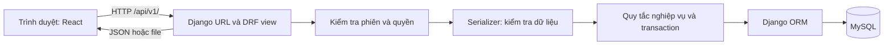

# Kiến trúc và tổ chức mã nguồn

V-Connect là website tiếng Việt gồm React JavaScript/Vite, API Django REST Framework và MySQL. Frontend, backend và tài liệu nằm trong cùng repository để thay đổi API có thể đi cùng giao diện và hướng dẫn tương ứng. Đây là một backend chia theo nghiệp vụ; các Django app không phải những dịch vụ chạy riêng.

## Đường đi của một yêu cầu

Ví dụ, khi Nhà tổ chức duyệt đơn, trình duyệt gửi yêu cầu kèm session cookie và CSRF token. Backend xác định người đăng nhập, kiểm tra quyền sở hữu hoạt động, trạng thái đơn và sức chứa trước khi lưu. Việc ẩn một nút trên giao diện không thay thế những kiểm tra này. Trình duyệt không truy cập trực tiếp MySQL.

Khi phát triển, Vite chuyển tiếp `/api` đến Django; trình duyệt dùng cùng origin cho giao diện và API. Proxy này chỉ thuộc dev server. Khi triển khai, reverse proxy phải cấu hình đường dẫn API và phục vụ bản build riêng; xem [vận hành và sao lưu](VAN_HANH_VA_SAO_LUU.md).

## Cấu trúc dự án

| Vị trí | Trách nhiệm |
|---|---|
| `backend/config/` | Một `settings.py`, URL cấp dự án, điểm vào WSGI/ASGI |
| `backend/apps/` | Model, API, quy tắc và kiểm thử của từng nghiệp vụ |
| `frontend/src/pages/` | Các trang và luồng tương tác |
| `frontend/src/components/` | Thành phần dùng chung, biểu mẫu và hộp xác nhận |
| `frontend/src/layouts/` | Bố cục công khai, Tình nguyện viên, Nhà tổ chức và Admin |
| `frontend/src/api/`, `hooks/`, `auth/` | Gọi API, vòng đời request, định dạng dữ liệu và trạng thái phiên |
| `frontend/e2e/` | Kiểm thử trình duyệt Playwright |
| `scripts/` | Chạy kiểm tra, E2E, đánh giá AI và sao lưu |
| `document/` | Tài liệu hiện hành theo chủ đề; bắt đầu tại [mục lục](README.md) |

`.venv`, `node_modules`, `dist`, dữ liệu media, model AI đã tải và bằng chứng trong `tmp` là dữ liệu môi trường hoặc dữ liệu sinh ra. Chúng không thay thế mã nguồn và lockfile. Bản sao lưu hoặc ảnh người dùng cần được phân biệt với file có thể tạo lại trước khi dọn thư mục.

## Các app backend hiện có

| App | Nội dung |
|---|---|
| `accounts` | Custom User, đăng ký/đăng nhập, phiên, đặt lại mật khẩu, hồ sơ và avatar |
| `core` | Danh mục kỹ năng, health, phân trang, cấu trúc lỗi, request log và seed |
| `activities` | Hoạt động, trạng thái, kỹ năng yêu cầu, ảnh bìa và chương trình |
| `participations` | Đơn đăng ký, xét duyệt, điểm danh thủ công/QR, lời mời và điểm đóng góp |
| `feedback` | Phản hồi, ẩn phản hồi và hỗ trợ phân tích bằng AI |
| `notifications` | Thông báo trong ứng dụng, tùy chọn email, hàng đợi và nhắc lịch |
| `reports` | Thống kê, báo cáo, xuất dữ liệu, bảng xếp hạng, ghép nối, khóa tài khoản và nhật ký |
| `recommendations` | Dịch vụ embedding local và lệnh chuẩn bị model dùng chung |

`core` chứa phần dùng chung, không phải nơi đưa mọi chức năng vào. Một quy tắc có vòng đời riêng nên nằm trong app nghiệp vụ tương ứng. Các app trên đã có triển khai; không còn là danh sách thư mục chuẩn bị cho các giai đoạn sau.

Trong mỗi app, `models.py` định nghĩa dữ liệu và ràng buộc; serializer chọn trường API và kiểm tra dữ liệu; view nhận yêu cầu và áp quyền; service thực hiện quy tắc cần dùng lại hoặc transaction. `urls.py` nối đường dẫn tới view. `admin.py` cấu hình Django Admin, khác với giao diện Admin React. `management/commands/` cung cấp lệnh chạy qua `manage.py`, ví dụ `seed_data`.

`manage.py` là điểm chạy các lệnh Django như `runserver`, `migrate`, `test`, `createsuperuser`. WSGI/ASGI là điểm vào dành cho server ứng dụng; sự tồn tại của `asgi.py` không tự cung cấp WebSocket hoặc thông báo đẩy realtime.

## Dữ liệu và tính nhất quán

User dùng UUID và kế thừa `AbstractUser` để dùng cơ chế mật khẩu/quyền của Django. `UserManager` tạo tài khoản, chuẩn hóa định danh và gọi `set_password()`; đây là công việc tạo bản ghi, khác với một đối tượng User biểu diễn tài khoản đã có. Quy tắc định danh hiện tại được mô tả trong [tài khoản và hồ sơ](TAI_KHOAN_VA_HO_SO.md).

Các quan hệ chính gồm: User có hồ sơ tổ chức hoặc tình nguyện; Activity thuộc Nhà tổ chức; Participation liên kết một Tình nguyện viên với một hoạt động; Attendance gắn với đơn; Feedback gắn với Attendance. Khóa duy nhất và quan hệ một-một ngăn bản ghi trùng ở database. UUID giúp định danh ổn định nhưng không cấp quyền truy cập.

Serializer kiểm tra thông tin có ý nghĩa nghiệp vụ; ràng buộc database giữ các điều kiện nền như trạng thái hợp lệ, thứ tự thời gian và khóa duy nhất. Các thao tác có thể tranh chấp chỗ hoặc trạng thái dùng transaction và khóa hàng theo quy tắc chung. Vì vậy, xử lý hai yêu cầu đồng thời cần được kiểm thử trên MySQL, không chỉ kiểm tra lần lượt trên giao diện.

MySQL dùng `utf8mb4`, strict mode và mức cô lập `read committed`. Django dùng datetime có múi giờ với `TIME_ZONE=Asia/Ho_Chi_Minh`; định dạng hiển thị thuộc frontend. Các quy tắc và chế độ thử về thời gian nằm trong [hoạt động và tham gia](HOAT_DONG_VA_THAM_GIA.md).

## API, lỗi và quan sát hệ thống

- API nghiệp vụ dùng tiền tố `/api/v1/`. Mặc định yêu cầu xác thực; endpoint công khai được khai báo riêng. Backend kiểm tra thêm vai trò và tài nguyên thuộc người nào.
- Danh sách dùng phân trang chuẩn `count`, `next`, `previous`, `results`; mặc định 20, `page_size` tối đa 100. Một số trang chọn 12 mục để phù hợp bố cục.
- Lỗi DRF có dạng `{"error":{"code":"…","message":"…","details":{}}}`. `details` giữ lỗi theo trường hoặc nội dung chi tiết. `getattr(exc, "default_code", "request_error")` lấy mã lỗi nếu exception có thuộc tính đó, nếu không dùng mã dự phòng.
- `apps/core/exceptions.py` chuẩn hóa lỗi DRF và cung cấp các handler 400/403/404/500 ở URL cấp dự án. Khi bật DEBUG, một số lỗi ngoài DRF có thể hiện trang debug của Django.
- Middleware gắn `X-Request-ID`, ghi method, path, status và thời gian xử lý. Nó không ghi body, cookie, header xác thực hay giá trị query.
- `/api/v1/health/` kiểm tra kết nối database **và** migration còn chờ; trả 503 nếu hệ thống chưa sẵn sàng. Không nên gọi liên tục trên mọi màn hình vì kiểm tra migration có chi phí.

Frontend gọi API qua `api/client.js`, gửi cookie và lấy CSRF token trước thao tác ghi. `useApi` quản lý tải/lỗi/thử lại, hủy request khi không cần và không hiển thị dữ liệu của bộ lọc cũ trong lúc chờ bộ lọc mới. `AuthProvider` giữ thông tin phiên; route guard hỗ trợ điều hướng theo vai trò, còn backend quyết định quyền cuối cùng.

## Cấu hình và migration

`BASE_DIR = Path(__file__).resolve().parent.parent` xác định thư mục `backend` từ vị trí file settings, không phụ thuộc terminal đang đứng ở đâu. `load_dotenv(BASE_DIR / ".env")` nạp cấu hình local. `required_env()` từ chối giá trị thiếu hoặc placeholder; `env_list()` tách chuỗi danh sách bằng dấu phẩy. Các biến boolean hiện được đọc bằng cách so chuỗi đã chuyển chữ thường với `"true"`.

Một file settings đọc giá trị khác nhau từ môi trường, không có nghĩa mọi nơi dùng chung bí mật hoặc DEBUG. `.env.example` mô tả cấu hình, `.env` chứa giá trị riêng. Biến `VITE_*` có thể xuất hiện trong bản build gửi tới trình duyệt, nên không chứa bí mật.

Migration là lịch sử thay đổi schema và dữ liệu có thể tái lập. Django dựng **trạng thái model tại từng migration** để biết lúc đó có trường và quan hệ nào. Trong data migration, dùng `apps.get_model()` để lấy model lịch sử; không nhập model hiện tại rồi giả định mọi trường/phương thức của nó tồn tại ở phiên bản cũ. `use_in_migrations=True` cho phép Django lưu manager vào trạng thái migration khi cần.

Thứ tự chạy do `dependencies` quyết định. Riêng tài khoản, migration username `0003` phụ thuộc `0001`; hồ sơ `0002` phụ thuộc `0003`. Đây là thứ tự đã được giữ để tương thích database đã áp dụng. Không đổi tên, xóa migration hoặc dùng `--fake` chỉ để làm số thứ tự trông liên tục. Sao lưu và đọc kế hoạch trước thay đổi schema; xem [kiểm thử và nâng cấp](TRANG_THAI_VA_KIEM_THU.md).

`seed_data` dùng `get_or_create` theo slug để bổ sung danh mục kỹ năng, chạy lại không ghi đè tên đã chỉnh. Lệnh không tạo tài khoản mặc định hay hoạt động mẫu. Lockfile Python và npm giúp tái lập dependency; chúng không thay thế kiểm tra tương thích môi trường.
